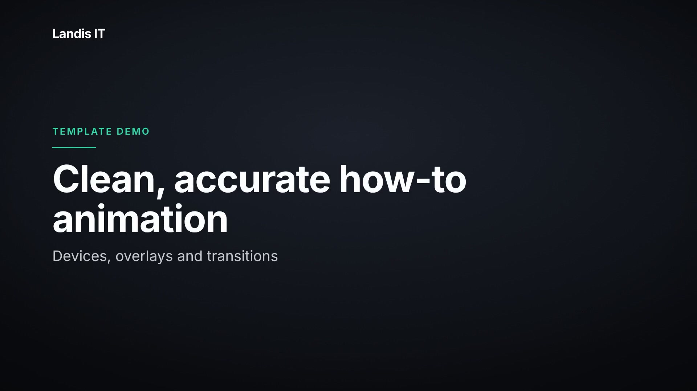
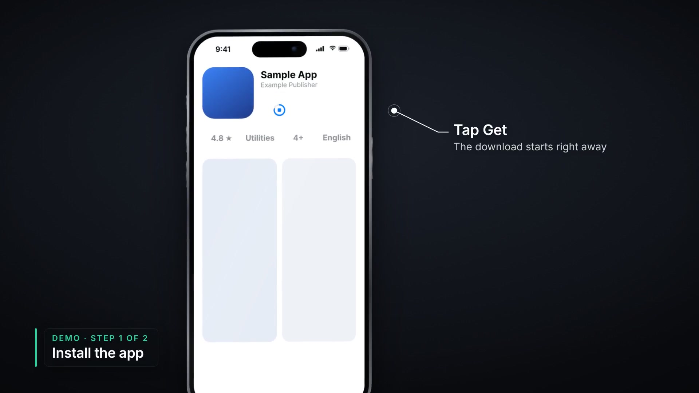
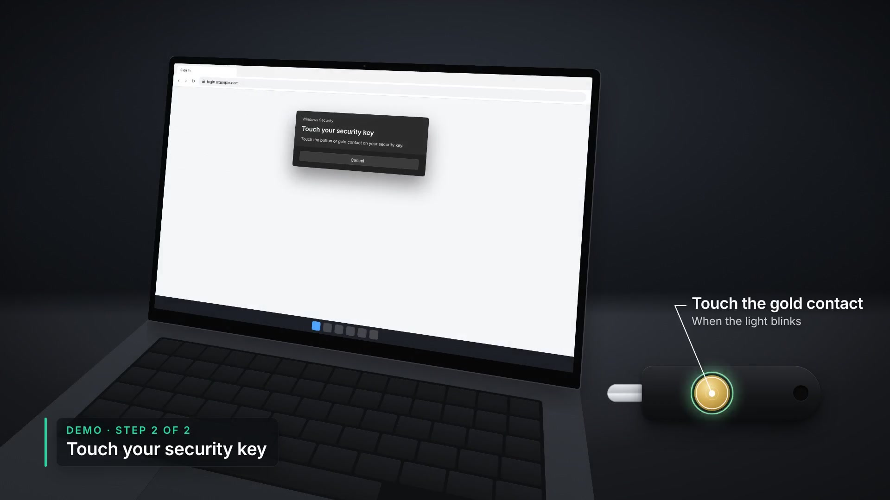

# Landis IT: animated how-to video studio

A Claude Code skill plus a Remotion workspace that turns reference recordings
of an IT procedure into a **fully animated**, customer-ready how-to video
(16:9, 4K) with a voiceover script, captions and chapter markers.

The footage you record is only a reference. Claude rebuilds every step as
clean animation: a realistic phone, a laptop on a desk, a FIDO2 key. The
on-screen UI is recreated from your footage so it's instruction-correct.

| Title | Phone step | Desk + security key |
|---|---|---|
|  |  |  |

_(Template demo with placeholder brand. Colors, fonts and logo come from the Landis design guide once it's ingested.)_

## How it works

1. **You drop in reference footage** (and say what it's for).
2. Claude extracts frames, writes up the procedure step by step, and checks it
   against known Microsoft behavior. **You confirm the steps.**
3. Claude writes the storyboard + narration script. **You approve it.**
4. Claude builds the animation and renders a 1080p draft with review stills.
   **You give notes until picture is locked.**
5. Voiceover is recorded or generated from the script and synced.
6. Claude renders the 4K final plus `script.md`, `captions.srt`,
   `chapters.txt` and a thumbnail.

The skill's rules live in `.claude/skills/landis-video-animation/`: motion
language, realism recipes, screen-recreation rules, accuracy and script
style, QA checklist.

## Setup (once per machine)

Requires Node.js 18+ and Git. Rendering works best on a machine with 8+ cores.

```bash
git clone <this repo>
cd landis-videoanimationskill/studio
npm install          # Remotion, fonts, and a full ffmpeg (no separate install needed)
npm run studio       # optional: live preview in the browser
```

Then open the repo folder in **Claude Code** (desktop app or CLI). The skill
loads automatically from `.claude/skills/`.

## Making a video

Copy your recordings into `projects/<slug>/reference/` (or give Claude the
file paths) and say, for example:

> Here's the reference footage for the Authenticator setup video.

Useful commands (Claude runs these for you):

```bash
node .claude/skills/landis-video-animation/scripts/new-project.mjs --slug vpn-setup --title "Connect to the VPN"
node .claude/skills/landis-video-animation/scripts/analyze-reference.mjs --project vpn-setup --input clip.mov
node .claude/skills/landis-video-animation/scripts/render.mjs --project vpn-setup --quality draft
node .claude/skills/landis-video-animation/scripts/render.mjs --project vpn-setup --quality final
```

## Current projects

| Slug | Video | Status |
|---|---|---|
| `authenticator-setup` | Install and set up Microsoft Authenticator | Brief drafted, waiting on footage |
| `passkeys` | Passkey in Authenticator, FIDO2 key, QR and key sign-in | Brief drafted, waiting on footage |
| `_demo` | Component demo / pattern library | Not for delivery |

## Before the first final render

- [ ] Design guide ingested into `studio/src/brand/tokens.ts` (see `references/brand.md`)
- [ ] Logo SVGs and licensed brand fonts in `studio/public/brand/`
- [ ] Support contact details for the end card
- [ ] Official Microsoft Authenticator icon (for store/app scenes)
- [ ] Decision: photographic hands/desk plates vs hands-free product style
